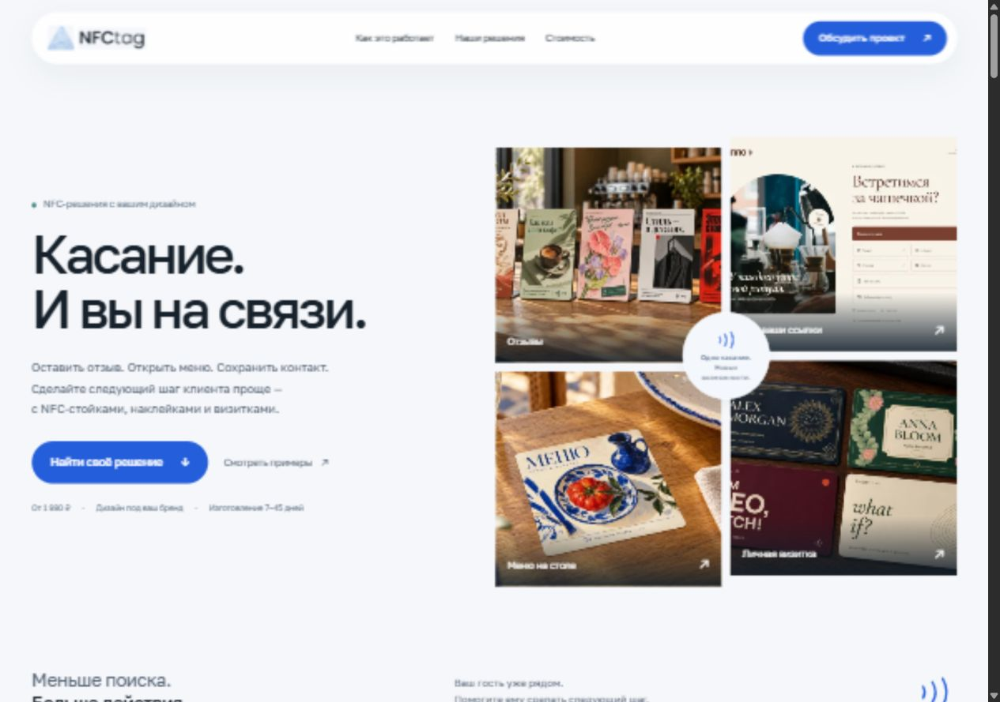

# NFCtag

Сайт NFC-решений для бизнеса: цифровое меню, визитки, страницы записи и заявок. В репозитории — исходный код витрины и интерактивные демонстрации.

[Открыть сайт](https://m1tski.gitverse.site/nfctag-site/)



## Возможности

- Адаптивная витрина работ и услуг с галереей, свайпами и просмотром изображений.
- Подбор решения и подготовка сообщения в Telegram.
- Демонстрации меню ресторана, страницы заявки, памятки и личной визитки.
- Управление анимацией и поддержка настройки reduced motion.
- Статический экспорт без серверной базы данных; формы демонстраций не оформляют реальные заказы.

## Стек и запуск

Next.js, React, TypeScript, CSS. Для разработки нужны Node.js 20.9+ и npm.

```sh
npm ci
npm run dev
```

Production-сборка: `npm run build`. Статический сайт создаётся в `out/`. Проверка экспорта: `node preview.mjs` (по умолчанию порт 3001).

Для размещения в подпапке можно задать `GITVERSE_BASE_PATH=/nfctag-site` при сборке.

## Структура

- `app/` — React-компоненты, данные, стили и интерактивные сценарии.
- `public/demos/` — демонстрации цифровых страниц.
- `public/demo-business/` — самостоятельная HTML/CSS/JS-визитка.
- `public/work/` — примеры дизайна.
- `public/assets/` — логотип, шрифты и лицензия Golos Text.

## Материалы

Макеты с названиями компаний представлены как примеры дизайна. Товарные знаки принадлежат их владельцам. Источники фотографий меню указаны в `public/demos/photo-credits.html` и `public/demos/media/food/sources.json`. Лицензия шрифта сохранена в `public/assets/Golos-OFL.txt`.
